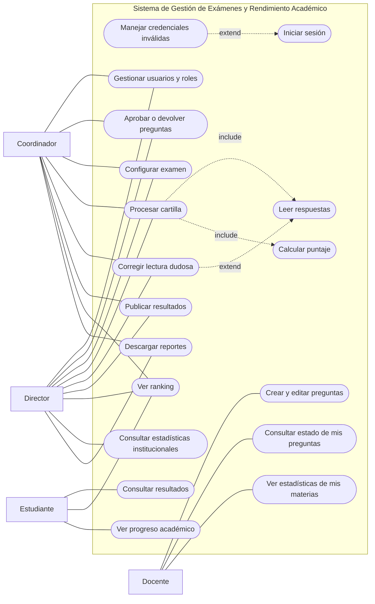

# Laboratorio 3 – Requisitos de Software

**Estado:** línea base actualizada el 5 de octubre de 2026. Reglas asociadas: `informe_reglas_de_negocio.md` v1.3. Las ampliaciones y precisiones de esta revisión figuran en la sección 8, sin asignar estimaciones ficticias.

**Proyecto:** Sistema de Gestión de Exámenes y Rendimiento Académico

## 1. Diagrama de casos de uso

### Actores y casos de uso

| Actor | Casos de uso directos | Casos de uso incluidos / extendidos |
|---|---|---|
| Estudiante | Consultar resultados, Ver ranking, Ver progreso académico | Requiere sesión autenticada |
| Docente | Crear y editar preguntas, Consultar estado de mis preguntas, Ver estadísticas de mis materias | Requiere sesión autenticada |
| Coordinador académico | Gestionar usuarios y roles dentro de su alcance, aprobar o devolver preguntas, configurar examen, procesar cartillas, publicar resultados y consultar ranking y reportes | No puede crear, modificar, desactivar ni asignar o retirar el rol DIRECTOR, ni modificar cuentas que lo tengan. Requiere sesión autenticada. |
| Director | Administrador principal: gestionar todos los usuarios y roles, realizar las operaciones del coordinador y consultar rankings, estadísticas y reportes institucionales | Requiere sesión autenticada; puede acceder a las funciones del coordinador sin necesitar un segundo rol. |
| Todos los usuarios | Iniciar sesión | Manejar credenciales inválidas (extiende Iniciar sesión) |

La autenticación es precondición de las operaciones; no exige volver a iniciar sesión en cada una.

### Diagrama

---

## 2. Features, épicas e historias de usuario (con estimación)

Convención de IDs: **RF.n** / **RNF.n** = feature, **EF.n.m** = épica, **HF.n.m.k** = historia. La columna *Pts.* es la estimación en puntos de historia (escala de Fibonacci). En las épicas, *Σ* es la suma de sus historias.

### RF.1 – Gestión de Usuarios y Accesos

| ID | Tipo | Perfil | Necesidad / Historia | Propósito | Pts. | Prioridad |
|---|---|---|---|---|---|---|
| **RF.1** | Feature | Todos / Coordinador | Gestión de usuarios y accesos | Controlar el acceso al sistema por roles | | ALTA |
| HF.1.1 | Historia | Todo usuario | Como usuario quiero iniciar sesión con mis credenciales para acceder a las funciones de mi rol | Garantizar acceso seguro y personalizado | 3 | ALTA |
| HF.1.2 | Historia | Director / Coordinador | El director administra todas las cuentas. El coordinador registra y administra docentes, coordinadores y estudiantes, sin modificar cuentas con rol DIRECTOR. | Administrar los usuarios de forma eficiente | 5 | ALTA |
| HF.1.3 | Historia | Director / Coordinador | El director asigna y retira cualquier rol; el coordinador puede asignar y retirar roles salvo DIRECTOR y no puede modificar cuentas con ese rol. Un estudiante solo puede tener el rol ESTUDIANTE. | Respetar la separación de responsabilidades | 3 | ALTA |
| | | | **Total RF.1** | | **11** | |

### RF.1 — Administración académica mínima añadida

| ID | Perfil | Historia | Prioridad | Estimación |
|---|---|---|---|---|
| HF.1.4 | Coordinador | Registrar, editar y desactivar estudiantes sin exigirles cuenta; vincular después una única cuenta sin duplicar su historial. | ALTA | Por estimar |
| HF.1.5 | Coordinador | Registrar y desactivar ciclos, grupos, ejes, materias y áreas; asignar materias a docentes y conservar referencias históricas. | ALTA | Por estimar |
| HF.1.6 | Coordinador | Cambiar el grupo o área de un estudiante, conservando periodos sin superposición; el día del cambio pertenece a la nueva asignación. | ALTA | Por estimar |

Estas historias completan RN-004, RN-007, RN-008, RN-009 y RN-038. Deben estar disponibles en R1; no implican pagos, matrícula económica ni asistencia.

### RF.2 – Gestión del Banco de Preguntas

| ID | Tipo | Perfil | Necesidad / Historia | Propósito | Pts. | Prioridad |
|---|---|---|---|---|---|---|
| **RF.2** | Feature | Docente / Coordinador | Gestión del banco de preguntas | Centralizar y reutilizar preguntas validadas | | ALTA |
| EF.2.1 | Épica | Docente | Crear y enviar preguntas | Aportar preguntas de calidad de forma ordenada | Σ 23 | ALTA |
| HF.2.1.1 | Historia | Docente | Como docente quiero crear una pregunta indicando su(s) área(s), eje temático, materia, tema, enunciado, alternativas y respuesta correcta para aportarla al banco | Enriquecer el banco de preguntas | 5 | ALTA |
| HF.2.1.2 | Historia | Docente | Como docente quiero ver el estado de mis preguntas (borrador, revisión, aprobada) para saber qué pasó con ellas | Evitar la falta de seguimiento en el envío de preguntas | 3 | ALTA |
| HF.2.1.3 | Historia | Docente | Como docente quiero editar una pregunta creando una nueva versión sin perder la anterior; si ya estaba aprobada, el cambio no requiere nueva aprobación y solo la nueva versión activa se ofrece para exámenes nuevos | Conservar el historial de versiones | 5 | ALTA |
| HF.2.1.4 | Historia | Docente | Como docente quiero adjuntar imágenes (figuras, ángulos, estructuras químicas, gráficos) al enunciado o a las alternativas de una pregunta, y que se conserven con cada versión, para plantear problemas que no se pueden expresar solo con texto | Permitir preguntas de Matemática, Física y Química | 5 | ALTA |
| HF.2.1.5 | Historia | Docente | Como docente quiero escribir fórmulas matemáticas y químicas (LaTeX) en el enunciado y en las alternativas, y ver una vista previa antes de guardar, para que el estudiante las lea correctamente | Permitir preguntas con notación científica | 5 | ALTA |
| EF.2.2 | Épica | Coordinador | Revisar y aprobar preguntas | Garantizar la calidad de las preguntas | Σ 8 | ALTA |
| HF.2.2.1 | Historia | Coordinador | Como coordinador quiero revisar y aprobar o devolver preguntas con una observación (la pregunta devuelta vuelve a borrador) para asegurar su calidad | Validar el contenido antes de usarlo en exámenes | 5 | ALTA |
| HF.2.2.2 | Historia | Coordinador | Como coordinador quiero consultar el banco filtrando por área, eje temático, materia y estado para encontrar preguntas rápido | Agilizar el armado de exámenes | 3 | ALTA |
| | | | **Total RF.2** | | **31** | |

### RF.3 – Gestión de Exámenes

| ID | Tipo | Perfil | Necesidad / Historia | Propósito | Pts. | Prioridad |
|---|---|---|---|---|---|---|
| **RF.3** | Feature | Coordinador | Gestión de exámenes | Armar exámenes con pesos y puntajes consistentes | | ALTA |
| EF.3.1 | Épica | Coordinador | Crear y configurar un examen | Reducir el tiempo de armado manual | Σ 24 | ALTA |
| HF.3.1.1 | Historia | Coordinador | Como coordinador quiero crear un examen por área seleccionando preguntas aprobadas del banco marcadas para esa área para armarlo rápidamente | Ahorrar tiempo en la elaboración de exámenes | 8 | ALTA |
| HF.3.1.2 | Historia | Coordinador | Como coordinador quiero definir el peso de cada eje temático y, por materia, la cantidad de preguntas y el puntaje por pregunta (que puede ser distinto en cada área), de modo que los pesos sumen 100% y los puntajes sumen el puntaje total del examen, para ajustar el examen a cada área | Permitir exámenes distintos por área | 5 | ALTA |
| HF.3.1.3 | Historia | Coordinador | Como coordinador quiero generar versiones A/B con las mismas versiones de preguntas y alternativas, cambiando únicamente el orden de preguntas y derivando la clave correspondiente | Controlar cada versión y su clave oficial | 5 | ALTA |
| HF.3.1.4 | Historia | Coordinador | Como coordinador quiero configurar expresamente una penalización opcional, desactivada por defecto, solo para respuestas únicas incorrectas; blancos y marcas múltiples valen 0 y el total mínimo es 0 | Permitir modelos de evaluación personalizados | 3 | MEDIA |
| HF.3.1.5 | Historia | Coordinador | Como coordinador quiero agrupar los exámenes de las áreas en un simulacro (con nombre y fecha) para aplicarlos y compararlos juntos | Gestionar cada aplicación como un conjunto | 3 | ALTA |
| EF.3.2 | Épica | Coordinador | Validar el examen antes de aplicarlo | Evitar errores en la calificación | Σ 6 | ALTA |
| HF.3.2.1 | Historia | Coordinador | Como coordinador quiero revisar y ajustar la clave de respuestas antes de calificar para asegurar precisión | Garantizar la exactitud en la calificación | 3 | ALTA |
| HF.3.2.2 | Historia | Coordinador | Como coordinador quiero importar las respuestas correctas desde un archivo de Excel para cargar la plantilla del examen con rapidez | Reducir el tiempo de carga manual | 3 | MEDIA |
| | | | **Total RF.3** | | **30** | |

### RF.4 – Calificación Automática

| ID | Tipo | Perfil | Necesidad / Historia | Propósito | Pts. | Prioridad |
|---|---|---|---|---|---|---|
| **RF.4** | Feature | Coordinador / Sistema | Calificación automática | Eliminar errores humanos y entregar resultados rápido | | ALTA |
| EF.4.1 | Épica | Coordinador | Registrar y leer cartillas | Evitar la corrección manual una por una | Σ 23 | ALTA |
| HF.4.1.1 | Historia | Coordinador | Como coordinador quiero registrar las cartillas de un examen por lote (carpeta de imágenes o PDF) y asociar cada una al estudiante y su versión; una nueva recepción reemplaza la anterior de la misma participación, conserva historial y motivo e impide rendir en otra área del simulacro | Saber quién participó en cada examen | 5 | ALTA |
| HF.4.1.2 | Historia | Sistema | Como sistema quiero leer automáticamente las respuestas marcadas en la imagen de la cartilla (escaneada o fotografiada) para obtener las respuestas del estudiante | Reemplazar la lectura manual | 13 | ALTA |
| HF.4.1.3 | Historia | Coordinador | Como coordinador quiero revisar y corregir las lecturas con confianza menor a 80% o con más de una alternativa marcada para asegurar que las respuestas sean correctas | Evitar errores por lecturas imprecisas | 5 | ALTA |
| EF.4.2 | Épica | Coordinador | Calcular y publicar resultados | Entregar resultados confiables y a tiempo | Σ 16 | ALTA |
| HF.4.2.1 | Historia | Sistema | Como sistema quiero comparar las respuestas con la clave oficial de la versión y calcular el puntaje para obtener el resultado | Calificar sin errores humanos | 8 | ALTA |
| HF.4.2.2 | Historia | Coordinador | Como coordinador quiero revisar los resultados calculados y publicarlos para que los estudiantes puedan verlos | Controlar cuándo se hacen visibles los resultados | 3 | ALTA |
| HF.4.2.3 | Historia | Coordinador | Como coordinador quiero recalificar con revisiones identificadas de clave y política, conservar los cálculos anteriores y, si el examen estaba publicado, mostrar automáticamente el nuevo puntaje y ranking cuando termine la validación | Corregir errores sin repetir el proceso | 5 | MEDIA |
| | | | **Total RF.4** | | **39** | |

### RF.5 – Resultados y Seguimiento Académico

| ID | Tipo | Perfil | Necesidad / Historia | Propósito | Pts. | Prioridad |
|---|---|---|---|---|---|---|
| **RF.5** | Feature | Estudiante | Resultados y seguimiento académico | Dar retroalimentación rápida y seguimiento del progreso | | ALTA |
| EF.5.1 | Épica | Estudiante | Consultar mis resultados | Identificar errores y saber qué reforzar | Σ 13 | ALTA |
| HF.5.1.1 | Historia | Estudiante | Como estudiante quiero ver mis resultados en cuanto el coordinador los publica para corregir mis errores a tiempo | Mejorar antes del siguiente examen | 3 | ALTA |
| HF.5.1.2 | Historia | Estudiante | Como estudiante quiero ver, por pregunta, mi respuesta marcada y la correcta para entender en qué me equivoqué | Aprender de mis errores | 5 | ALTA |
| HF.5.1.3 | Historia | Estudiante | Como estudiante quiero ver el desglose de aciertos y errores por materia para priorizar mi estudio | Enfocar el esfuerzo en las áreas débiles | 5 | ALTA |
| EF.5.2 | Épica | Estudiante | Seguir mi progreso y mi posición | Motivarme y planificar mi estudio | Σ 10 | ALTA |
| HF.5.2.1 | Historia | Estudiante | Como estudiante quiero ver mi posición en el ranking de un examen para compararme con mis compañeros | Motivarme a mejorar | 5 | ALTA |
| HF.5.2.2 | Historia | Estudiante | Como estudiante quiero ver un gráfico de mi evolución por examen para entender mi tendencia | Planificar mejor mi estudio | 5 | ALTA |
| | | | **Total RF.5** | | **23** | |

### RF.6 – Reportes y Estadísticas

| ID | Tipo | Perfil | Necesidad / Historia | Propósito | Pts. | Prioridad |
|---|---|---|---|---|---|---|
| **RF.6** | Feature | Coordinador / Docente / Director | Reportes y estadísticas | Apoyar la toma de decisiones | | MEDIA |
| HF.6.1 | Historia | Coordinador | Como coordinador quiero consultar el ranking de un examen de un área dentro de un simulacro y filtrarlo por materia, sin mezclar participantes de otras fechas o áreas | Tomar decisiones pedagógicas informadas | 5 | MEDIA |
| HF.6.2 | Historia | Docente | Como docente quiero ver cómo respondieron los estudiantes a las preguntas de mis materias para mejorar mis preguntas y mi enseñanza | Mejorar la calidad de las preguntas | 5 | MEDIA |
| HF.6.3 | Historia | Director | Como director quiero ver estadísticas institucionales (promedios por área y evolución entre exámenes) para decidir estrategias | Tomar decisiones estratégicas a tiempo | 8 | MEDIA |
| HF.6.4 | Historia | Director / Coordinador | Como director o coordinador quiero descargar reportes en PDF o Excel para compartirlos | Facilitar la presentación de resultados | 8 | BAJA |
| HF.6.5 | Historia | Coordinador | Como coordinador quiero ver en un panel lo pendiente (preguntas por aprobar, lecturas por revisar, resultados por publicar) para priorizar mi trabajo | Atender primero lo que bloquea la publicación | 3 | MEDIA |
| | | | **Total RF.6** | | **29** | |

### RNF.1 – Seguridad

| ID | Tipo | Perfil | Necesidad / Historia | Propósito | Feature relacionada | Pts. | Prioridad |
|---|---|---|---|---|---|---|---|
| **RNF.1** | Feature NF | Sistema | Seguridad | Proteger la información de usuarios, preguntas y resultados | | | ALTA |
| HNF.1.1 | Historia | Sistema | Como sistema quiero almacenar las contraseñas con un hash seguro (bcrypt o equivalente) para proteger las credenciales | Garantizar confidencialidad | RF.1 | 3 | ALTA |
| HNF.1.2 | Historia | Sistema | Como sistema quiero controlar el acceso a las funciones según el rol del usuario para evitar accesos no autorizados | Mantener la separación de responsabilidades | RF.1 a RF.6 | 5 | ALTA |
| | | | **Total RNF.1** | | | **8** | |

### RNF.2 – Rendimiento y disponibilidad

| ID | Tipo | Perfil | Necesidad / Historia | Propósito | Feature relacionada | Pts. | Prioridad |
|---|---|---|---|---|---|---|---|
| **RNF.2** | Feature NF | Sistema | Rendimiento y disponibilidad | Garantizar una experiencia fluida | | | MEDIA |
| HNF.2.1 | Historia | Sistema | Como sistema quiero responder las consultas habituales (resultados, ranking, banco de preguntas) en menos de 3 segundos | Que los usuarios no esperen | RF.2, RF.5 | 3 | MEDIA |
| HNF.2.2 | Historia | Sistema | Como sistema quiero procesar un lote de 100 cartillas en menos de 10 minutos | Entregar resultados el mismo día del examen | RF.4 | 3 | MEDIA |
| | | | **Total RNF.2** | | | **6** | |

### RNF.3 – Usabilidad

| ID | Tipo | Perfil | Necesidad / Historia | Propósito | Feature relacionada | Pts. | Prioridad |
|---|---|---|---|---|---|---|---|
| **RNF.3** | Feature NF | Todos | Usabilidad | Facilitar el uso del sistema | | | ALTA |
| HNF.3.1 | Historia | Estudiante | Como estudiante quiero ver mis resultados correctamente desde un celular con pantalla de 360 px de ancho o más para revisarlos en cualquier momento | Aumentar la accesibilidad | RF.5 | 5 | ALTA |
| HNF.3.2 | Historia | Coordinador | Como coordinador quiero poder configurar un examen completo en menos de 15 minutos tras una capacitación de 1 hora, aunque hoy trabaje con Excel y Word | Reducir el tiempo de adaptación | RF.2, RF.3, RF.4 | 3 | ALTA |
| | | | **Total RNF.3** | | | **8** | |

### RNF.4 – Confiabilidad e integridad de datos

| ID | Tipo | Perfil | Necesidad / Historia | Propósito | Feature relacionada | Pts. | Prioridad |
|---|---|---|---|---|---|---|---|
| **RNF.4** | Feature NF | Sistema | Confiabilidad e integridad de datos | Que los resultados sean confiables y verificables | | | ALTA |
| HNF.4.1 | Historia | Sistema | Como sistema quiero señalar para revisión las lecturas con confianza menor a 80% o con más de una alternativa marcada, en lugar de asumirlas | Evitar calificaciones erróneas | RF.4 | 5 | ALTA |
| HNF.4.2 | Historia | Sistema | Como sistema quiero conservar el historial (versiones de preguntas, resultados y configuraciones) sin eliminarlo | Permitir análisis de evolución y trazabilidad | RF.2, RF.3, RF.5 | 3 | ALTA |
| | | | **Total RNF.4** | | | **8** | |

### RNF.5 – Privacidad y cumplimiento legal (requisito externo)

| ID | Tipo | Perfil | Necesidad / Historia | Propósito | Feature relacionada | Pts. | Prioridad |
|---|---|---|---|---|---|---|---|
| **RNF.5** | Feature NF | Sistema | Privacidad y cumplimiento legal | Proteger los datos personales de los estudiantes, que pueden ser menores de edad | | | ALTA |
| HNF.5.1 | Historia | Sistema | Como sistema quiero mostrar los datos personales de un estudiante (DNI, teléfono, correo) solo a los roles autorizados | Limitar el acceso a datos sensibles | RF.1, RF.5 | 3 | ALTA |
| HNF.5.2 | Historia | Sistema | Como sistema quiero registrar solo los datos personales necesarios y cumplir la Ley de Protección de Datos Personales del Perú (Ley 29733) | Cumplir la normativa vigente | RF.1 | 3 | ALTA |
| | | | **Total RNF.5** | | | **6** | |

**Estimación anterior de referencia:** funcionales 163 pts; no funcionales 36 pts; **199 pts**. No representa el total corregido: HF.1.4–HF.1.6 y los cambios de alcance requieren reestimación del equipo. No se inventan puntos adicionales.

> Los valores numéricos de los RNF (3 segundos, 100 cartillas en 10 minutos, 80% de confianza, 15 minutos, 360 px, 2 MB por imagen) son metas propuestas; deben validarse con la coordinadora.

> Los puntajes por pregunta y totales conservan hasta 9 decimales, sin redondeo ni reducción de precisión al sumar o guardar. Se rechazan entradas con más precisión antes de persistirlas. Los pesos se configuran por eje; el puntaje de materia se deriva de cantidad × puntaje por pregunta y se comprueban igualdades exactas.

> Cada publicación conserva sus resultados y puestos. Estadísticas, perfil y evolución se consultan a partir de la publicación vigente de cada examen. La recalificación finalizada publica automáticamente una nueva edición y preserva las anteriores. Empates exactos: 1, 1, 3. No hay ranking acumulado entre simulacros ni entre áreas.

> Ningún registro académico se elimina desde la interfaz: quitar significa desactivar.

> No hay un módulo de auditoría general (RN-034 del informe vigente). Se conservan las versiones de preguntas, las correcciones manuales con usuario y motivo, y el responsable y fecha de aprobación inicial, las revisiones de clave y política y cada publicación.

---

## 3. Clasificación: requisitos funcionales y no funcionales

| Tipo | Descripción | Feature asociada | Prioridad |
|---|---|---|---|
| RF | Login, registro y roles de usuarios | RF.1 – Gestión de Usuarios y Accesos | ALTA |
| RF | Creación, edición, aprobación y versionado de preguntas | RF.2 – Banco de Preguntas | ALTA |
| RF | Creación y configuración de exámenes por área, con versiones y clave | RF.3 – Gestión de Exámenes | ALTA |
| RF | Registro y lectura de cartillas, cálculo de puntaje y publicación | RF.4 – Calificación Automática | ALTA |
| RF | Resultados, detalle de errores, ranking y progreso del estudiante | RF.5 – Resultados y Seguimiento | ALTA |
| RF | Rankings filtrados, estadísticas y reportes | RF.6 – Reportes y Estadísticas | MEDIA |
| RNF | Hash seguro de contraseñas, control de acceso por rol (cualidad de ejecución) | RNF.1 – Seguridad | ALTA |
| RNF | Consultas en menos de 3 s, 100 cartillas en menos de 10 min (cualidad de ejecución) | RNF.2 – Rendimiento y disponibilidad | MEDIA |
| RNF | Visualización correcta desde 360 px de ancho y configuración de un examen en menos de 15 min (cualidad de ejecución) | RNF.3 – Usabilidad | ALTA |
| RNF | Lecturas con confianza menor a 80% señaladas e historial conservado (cualidad de ejecución) | RNF.4 – Confiabilidad | ALTA |
| RNF | Datos personales protegidos y cumplimiento de la Ley 29733 (requisito externo) | RNF.5 – Privacidad y cumplimiento legal | ALTA |

---

## 4. Priorización de requisitos

| ID | Feature | Valor | Costo | Riesgo | Prioridad |
|---|---|---|---|---|---|
| RF.1 | Gestión de Usuarios y Accesos | Alto | Bajo | Bajo | **ALTA – DEBE** |
| RF.2 | Banco de Preguntas | Alto | Medio | Bajo | **ALTA – DEBE** |
| RF.3 | Gestión de Exámenes | Alto | Medio | Medio | **ALTA – DEBE** |
| RF.4 | Calificación Automática | Muy alto | Alto | Alto (lectura de cartillas) | **ALTA – DEBE** |
| RF.5 | Resultados y Seguimiento | Alto | Medio | Bajo | **ALTA – DEBE** |
| RNF.1 | Seguridad | Alto | Medio | Medio | **ALTA – DEBE** |
| RNF.4 | Confiabilidad e integridad | Alto | Medio | Medio | **ALTA – DEBE** |
| RNF.3 | Usabilidad | Alto | Medio | Bajo | **ALTA – DEBE** |
| RF.6 | Reportes y Estadísticas | Medio | Alto | Bajo | **MEDIA – DEBERÍA** |
| RNF.2 | Rendimiento y disponibilidad | Medio | Medio | Medio | **MEDIA – DEBERÍA** |
| RNF.5 | Privacidad y cumplimiento legal | Alto | Bajo | Bajo | **ALTA – DEBE** |

---

## 5. Gestión de entregas (releases)

La tabla conserva los puntos de la estimación anterior para trazabilidad; las fechas y cargas deben replanificarse tras estimar los cambios. R1 incorpora HF.1.4–HF.1.6. La protección de datos personales y el historial se aplican desde que nace el dato: HNF.5.1 comienza en R1; HNF.4.2 se implementa en R1 para preguntas y en R2 para claves, políticas, cartillas y resultados. R3 completa la consulta del historial y la recalificación. El panel completo puede llegar en R3; las funciones de R1/R2 deben ser accesibles sin depender de ese panel.

| Release | Features | Historias seleccionadas | Pts. | Inicio | Fin | Responsable |
|---|---|---|---|---|---|---|
| Release 1 | RF.1, RF.2, RNF.1, RNF.5 (parcial) | HF.1.1, HF.1.2, HF.1.3, HF.2.1.1, HF.2.1.2, HF.2.1.3, HF.2.1.4, HF.2.1.5, HF.2.2.1, HF.2.2.2, HNF.1.1, HNF.1.2, HNF.5.2, HNF.5.1 (base), HNF.4.2 (preguntas), HF.1.4–HF.1.6 | 53 + reestimación | Semana 1 | Semana 4 | *(asignar)* |
| Release 2 | RF.3, RF.4 (núcleo y revisión de lecturas), RNF.4 (parcial) | HF.3.1.1, HF.3.1.2, HF.3.1.3, HF.3.2.1, HF.3.1.5, HF.4.1.1, HF.4.1.2, HF.4.1.3, HF.4.2.1, HF.4.2.2, HNF.4.1, HNF.4.2 (evaluaciones) | 63 + reestimación | Semana 5 | Semana 8 | *(asignar)* |
| Release 3 | RF.5, RF.6 (panel del coordinador), RF.4 (recalificación), RF.3 (penalización e importación de la clave desde Excel), RNF.3, RNF.4 (historial), RNF.5 (parcial) | HF.5.1.1, HF.5.1.2, HF.5.1.3, HF.5.2.1, HF.5.2.2, HF.4.2.3, HF.3.1.4, HF.3.2.2, HF.6.5, HNF.3.1, HNF.3.2, HNF.4.2 (consulta), HNF.5.1 (verificación integral) | 51 + reestimación | Semana 9 | Semana 12 | *(asignar)* |
| Release 4 (si el tiempo lo permite) | RF.6, RNF.2 | HF.6.1, HF.6.2, HF.6.3, HF.6.4, HNF.2.1, HNF.2.2 | 32 | Semana 13 | Semana 16 | *(asignar)* |

> La historia HF.4.1.2 (lectura automática de cartillas) es la de mayor riesgo. Conviene hacer un prototipo técnico en paralelo durante el Release 1 para validarla antes del Release 2.

> La revisión de lecturas dudosas (HF.4.1.3, HNF.4.1) está en el Release 2 para no calificar sin revisar, y HNF.5.2 está en el Release 1 porque los datos de estudiantes se registran desde ese release. Las pantallas de RF.6 (panel del director, estadísticas de mis materias, reportes) se diseñan en el prototipo de la Práctica 8, aunque su implementación está en el Release 4.

> Fuera del alcance de esta versión: generar el examen impreso (PDF) con sus imágenes y fórmulas. Queda como mejora futura; el modelo de datos ya conserva la versión exacta de cada pregunta, con sus imágenes y fórmulas.

> Alcance de la entrega del curso: los Releases 1 a 3 (167 pts en la estimación anterior; total corregido pendiente de reestimar) forman el MVP que se entrega funcionando; el Release 4 (32 pts) se hace solo si el tiempo lo permite. El prototipo (Práctica 8) diseña las pantallas de todos los releases.

> La carga del Release 2 (63 pts) es la mayor porque incluye la lectura de cartillas (HF.4.1.2, 13 pts); por eso la importación de la clave desde Excel (HF.3.2.2) pasó al Release 3.

---

## 6. Gestión del proyecto en Trello

**Enlace de Trello:** https://trello.com/invite/b/6a01f35ff286ed0f23f5fc1a/ATTI9241d2701d26b12bc4001acac7bebc276812476D/sistema-academico

**Estructura propuesta del tablero** (nombre: *Sistema de Gestión de Exámenes y Rendimiento Académico*, plantilla *User Story Mapping*):

| Elemento | Definición |
|---|---|
| Backbone (columnas por usuario) | Coordinador, Docente, Estudiante, Director, Sistema |
| Tarjetas de feature | `RF.1: Gestión de Usuarios y Accesos`, `RF.2: Banco de Preguntas`, `RF.3: Gestión de Exámenes`, `RF.4: Calificación Automática`, `RF.5: Resultados y Seguimiento`, `RF.6: Reportes y Estadísticas`, `RNF.1: Seguridad`, etc. |
| Tarjetas de épica e historia | `EF.2.1 Crear y enviar preguntas`, `HF.2.1.1 Crear pregunta`; ordenadas verticalmente por valor bajo su feature |
| Descripción de cada tarjeta | Formato de Mike Cohn: *Como (perfil) quiero (necesidad) para (propósito)* |
| Listas del flujo de trabajo | Backlog, Sprint actual, En progreso, En pruebas, Completado, Aceptado, Bloqueado |
| Etiquetas | Un color por feature y una etiqueta por release (R1, R2, R3, R4) |
| Responsables y fechas | Miembro asignado e inicio/fin en cada tarjeta |

**Checklist modelo para una historia:**

- Implementación: diseñar la interfaz, programar la lógica, persistir en la base de datos, validar entradas, manejar errores.
- Pruebas: diseñar casos de prueba, pruebas unitarias, prueba de integración, validación con la coordinadora.

## 7. Criterios de aceptación consolidados

El recorrido conceptual vigente de los casos del coordinador está en `CASOS_USO_COORDINADOR_REVISION.md`; el modelo y sus contratos están en `MODELO_DDD_PROPUESTA.md`. Son criterios de diseño y resultados esperados, no pruebas ejecutadas de una implementación.

La corrección de una lectura registra lo observado en la cartilla. Una marca múltiple confirmada se conserva como evidencia y se califica como blanco, 0 puntos. Nunca se completa automáticamente con la respuesta correcta de la clave.

## 8. Correcciones de la revisión por casos de uso — 5 de octubre de 2026

Las decisiones siguientes fueron confirmadas por el usuario. Complementan la línea base y prevalecen sobre formulaciones anteriores que no contemplaban estas excepciones. Los puntos y fechas anteriores no se recalculan automáticamente: el equipo debe reestimar la ampliación.

| Historia | Operación y criterio de aceptación | Relación |
|---|---|---|
| HF.1.7 — Recuperación de acceso | Recuperar acceso previa verificación de identidad y credencial de un solo uso con caducidad; no revelar contraseñas anteriores ni crear otro estudiante. Canal de entrega por concretar en implementación. | Completa HF.1.1; ajuste operativo del diseño. |
| HF.1.8 — Rectificar historial | Coordinador conserva historia anterior y corregida, motivo, responsable y fecha; valida periodos. Estadísticas usan el grupo corregido sin modificar puntajes/puestos publicados. Un participante sin grupo figura como tal. | HF.1.6; RN-042. |
| HF.4.1.4 — Resolver carga pendiente | Conservar archivo/página y estado; resolver estudiante/A/B, errores de archivo y reintentos sin duplicados. No asumir identidad ni blanco. | HF.4.1.1; RN-041. |
| HF.4.1.5 — Rectificar asociación | Corregir estudiante/examen/cuadernillo equivocados con evidencia e historial, conservar origen y una única participación válida por simulacro, recalcular exámenes afectados. | RN-039. |
| HF.4.1.6 — Recibir cartilla tardía | Admitir primera cartilla después de publicar con motivo y responsable; al validar resultados se publica automáticamente una nueva edición completa. | RN-040. |
| HF.4.1.7 — Resolver entrada inválida | Imagen ilegible espera reemplazo trazable. Entrada duplicada/ajena puede descartarse con motivo y evidencia; una recepción ya creada requiere reemplazo o rectificación. | RN-041. |
| HF.4.2.4 — Recuperar publicación pendiente | Mostrar estado y error, permitir reintento sin duplicar ediciones y rechazar lotes obsoletos. Puntaje, detalle y ranking se activan juntos. | HF.4.2.3; RN-044. |

**Precisiones de historias existentes:**

- HF.2.2.1 revisa la versión efectivamente abierta; una edición simultánea obliga a revisar la nueva versión antes de aprobar inicialmente. HF.2.2.2 conserva consulta filtrada, y HF.2.1.1 mantiene el tema dentro del contenido versionado.
- HF.3.1.1 impide repetir una misma pregunta dentro de un examen e informa faltantes de preguntas elegibles por materia. HF.3.2.2 exige previsualización y validación completa de Excel. HF.3.2.1 selecciona claves A/B y política como conjunto coherente identificado (RN-043).
- HF.4.2.2 incluye consulta interna de resultados calculados, revisión registrada y comprobación de pendientes de importación, además de la primera publicación manual.
- HF.4.2.3 distingue recalcular por una lectura, por clave o por política. Cambiar de conjunto genera cálculos nuevos bajo ese conjunto; el ranking siempre corresponde al examen completo. Confirmar una nueva lectura usada para corregir un resultado inicia el recálculo correspondiente.
- HF.6.5 incluye preguntas, entradas sin identificar, lecturas pendientes, cálculos por revisar y publicaciones pendientes, con acceso a la acción necesaria. Las consultas de ediciones históricas forman parte del seguimiento de recalificaciones.
- La lectura de cartillas puede detenerse en revisión o identificación; importar no garantiza que pueda calcularse inmediatamente. La sesión autenticada y el rol autorizado son precondiciones comunes; no se repite el inicio de sesión en cada operación.

**Entrega:** identificación y resolución de importaciones acompañan a la recepción de R2. Historial y rectificación administrativa deben conservarse desde la creación del dato; su impacto sobre exámenes ya publicados requiere el flujo de recalificación de R3. Recuperación de acceso acompaña al acceso de R1. La recepción tardía y recuperación de publicación se completan junto al flujo de R3. Estas dependencias requieren replanificación, sin prometer los plazos/puntos antiguos. Los reportes avanzados y exportación PDF/Excel continúan en R4 opcional.

**Límites de arquitectura:** Publicación y ranking permanece separado de Evaluación. Recibe un contrato de resultados completos y versionados, conserva su propia edición y no modifica cartillas ni lecturas. La solución inicial usa módulos dentro de una aplicación y transacciones locales; no presupone microservicios.
