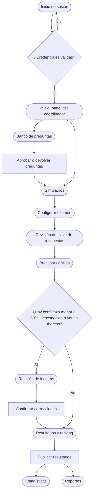
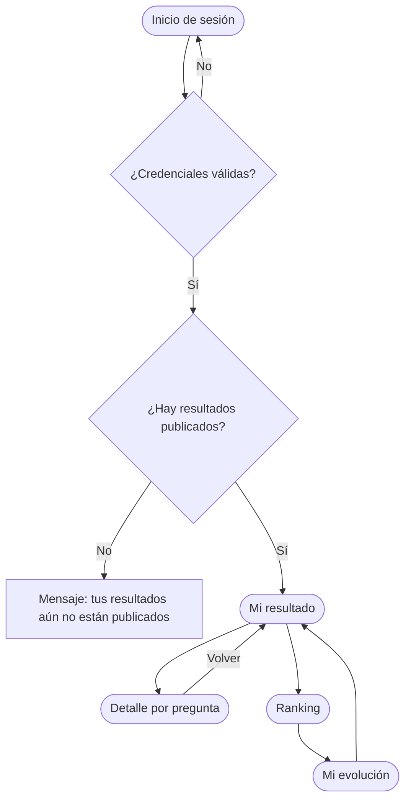
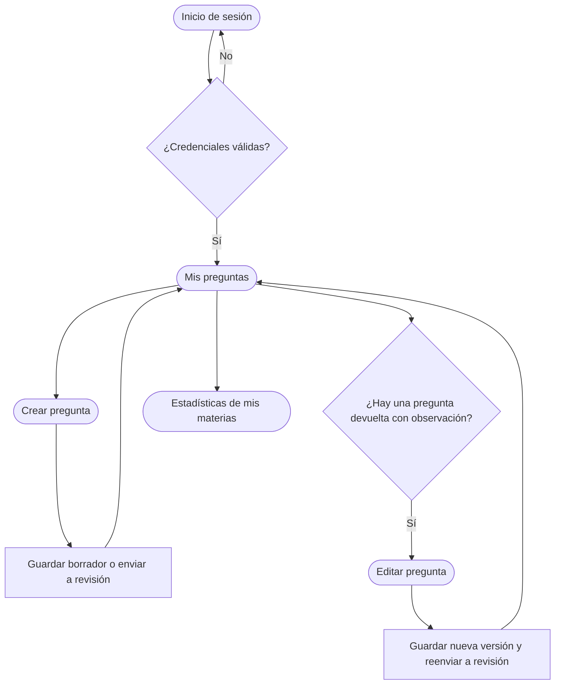
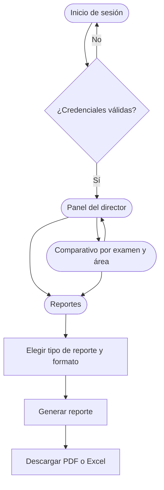

# Práctica 8 – Prototipo Inicial

**Partes 3 y 4:** flujos de usuario y validación y refinamiento del prototipo.

**Proyecto:** Sistema de Gestión de Exámenes y Rendimiento Académico

**Personas:** Patricia Salazar (coordinadora, persona principal), Pedro Gómez (estudiante), Juan (docente) y Ricardo Medina (director).

---

## 3. Flujos de usuario

Cada flujo vincula las pantallas del prototipo necesarias para que una persona complete su objetivo. Los óvalos son pantallas; los rombos son decisiones del sistema; los rectángulos son acciones dentro de una pantalla.

### Flujo 1 – Patricia: calificar un simulacro y publicar los resultados

**Objetivo:** dejar listos y publicados los resultados de un simulacro, de forma rápida y sin errores.

| Paso | Pantalla | Acción de Patricia | Siguiente |
|---|---|---|---|
| 1 | Inicio de sesión | Ingresa su usuario y contraseña | Inicio, o el mismo formulario con mensaje de error |
| 2 | Inicio (panel) | Ve cuántas preguntas por aprobar, lecturas por revisar y resultados por publicar tiene | Banco de preguntas o Simulacros |
| 3 | Banco de preguntas | Revisa una pregunta y la aprueba o la devuelve con una observación | Simulacros |
| 4 | Simulacros | Crea el simulacro o abre uno existente y elige el examen de un área | Configurar examen |
| 5 | Configurar examen | Define cantidad de preguntas, pesos y puntajes; genera A/B reordenando las mismas preguntas y sus respectivas claves | Revisión de clave |
| 6 | Revisión de clave de respuestas | Revisa o ajusta la clave y la confirma | Procesar cartillas |
| 7 | Procesar cartillas | Carga el lote de cartillas, las asocia al estudiante y deja que el sistema lea las respuestas | Revisión de lecturas, o Resultados si no hay dudas |
| 8 | Revisión de lecturas | Verifica baja confianza o varias marcas e indica el motivo; la doble marca confirmada se registra como blanco, 0 puntos | Resultados y ranking |
| 9 | Resultados y ranking | Revisa resultados completos y publica el examen con su ranking | Estadísticas o Reportes |
| 10 | Estadísticas / Reportes | Consulta el rendimiento y descarga el reporte en PDF o Excel | Fin |

**Features que cubre:** Aprobar preguntas del banco, Crear simulacro, Configurar examen por área, Revisar clave de respuestas, Registrar cartilla y leer respuestas, Corregir lecturas dudosas, Calcular y publicar resultados, Consultar ranking y reportes.

### Flujo 2 – Pedro: conocer sus errores y compararse (celular)

**Objetivo:** saber cuánto sacó, en qué se equivocó y cómo va frente a sus compañeros para mejorar en el siguiente examen.

| Paso | Pantalla | Acción de Pedro | Siguiente |
|---|---|---|---|
| 1 | Inicio de sesión | Ingresa desde su celular con su usuario y contraseña | Mi resultado, o mensaje si aún no hay resultados publicados |
| 2 | Mi resultado | Ve su puntaje, su posición y el desglose por materia | Detalle por pregunta, Ranking o Mi evolución |
| 3 | Detalle por pregunta | Revisa qué marcó y cuál era la correcta en cada pregunta, filtrando por materia | Volver a Mi resultado |
| 4 | Ranking | Compara su posición con la de otros estudiantes del examen | Mi evolución |
| 5 | Mi evolución | Revisa su puntaje y su posición a lo largo de los exámenes | Mi resultado |

**Features que cubre:** Iniciar sesión, Consultar resultados publicados, Ver detalle de errores por pregunta y materia, Ver ranking y evolución.

### Flujo 3 – Juan: aportar preguntas y ver cómo respondieron los estudiantes

**Objetivo:** que sus preguntas sean aprobadas para los simulacros y mejorarlas a partir del desempeño de los estudiantes.

| Paso | Pantalla | Acción de Juan | Siguiente |
|---|---|---|---|
| 1 | Inicio de sesión | Ingresa su usuario y contraseña | Mis preguntas, o el mismo formulario con mensaje de error |
| 2 | Mis preguntas | Ve el estado de cada pregunta (borrador, revisión, aprobada) y las observaciones del coordinador; filtra por materia o estado | Crear pregunta, Editar pregunta o Estadísticas |
| 3 | Crear pregunta | Indica áreas, eje temático, materia y tema; escribe el enunciado y las alternativas, adjunta imágenes o fórmulas y marca la respuesta correcta | Mis preguntas, con la pregunta en borrador o en revisión |
| 4 | Editar pregunta | Lee la observación del coordinador, corrige la pregunta y guarda una nueva versión; la anterior se conserva | Mis preguntas, con la pregunta otra vez en revisión |
| 5 | Estadísticas de mis materias | Consulta cuántas veces se respondió cada pregunta, su porcentaje de acierto y su dificultad observada | Mis preguntas |

**Features que cubre:** Crear y editar preguntas, Consultar estado de mis preguntas, Editar pregunta conservando versiones, Ver estadísticas de mis materias.

### Flujo 4 – Ricardo: revisar el rendimiento de la academia y descargar reportes

**Objetivo:** contar con información institucional oportuna para decidir acciones de mejora.

| Paso | Pantalla | Acción de Ricardo | Siguiente |
|---|---|---|---|
| 1 | Inicio de sesión | Ingresa su usuario y contraseña | Panel del director, o el mismo formulario con mensaje de error |
| 2 | Panel del director | Revisa estudiantes evaluados, promedio general, puntajes máximo y mínimo, y el promedio por área | Comparativo por examen y área, o Reportes |
| 3 | Comparativo por examen y área | Filtra por área y exámenes del ciclo, y compara participantes, promedio y variación entre exámenes | Panel del director o Reportes |
| 4 | Reportes | Elige el tipo de reporte (institucional, por examen, por área o por materia) y el formato (PDF o Excel), y lo genera | Descarga del reporte |
| 5 | Reportes | Descarga el reporte desde la lista de reportes generados | Fin |

**Features que cubre:** Iniciar sesión, Consultar estadísticas institucionales, Comparar rendimiento entre exámenes y áreas, Descargar reportes.

---

## 4. Validación y refinamiento

### Escenarios pendientes de validación con usuarios

No se han realizado entrevistas ni pruebas de usabilidad en esta corrección. Estos son los criterios a ejecutar y registrar, no resultados ficticios de validación:

| Escenario | Resultado esperado |
|---|---|
| Editar pregunta aprobada | Nueva versión activa sin nueva aprobación; contenido histórico intacto. |
| Crear cuadernillo B | Mismas versiones de preguntas y alternativas que A, solo cambia el orden. |
| Peso por eje incompatible con puntajes | Rechazo sin redondear ni ajustar valores silenciosamente. |
| Doble marca con confianza alta | Revisión; si se confirma, blanco y 0 puntos. |
| Segunda cartilla del estudiante | Reemplaza la recepción de la misma participación, conserva motivo e historial. |
| Cartilla de otra área del mismo simulacro | Rechazo: solo una participación por estudiante y simulacro. |
| Recalificar examen publicado | Al terminar y validar, el estudiante ve el nuevo puntaje y ranking automáticamente. |
| Consultar publicación anterior | Se conserva su puntaje y puesto originales. |
| 6 correctas, 2 incorrectas y 2 blancas | 60 % aciertos, 20 % errores y 20 % blancos. |

### Flujo complementario: reemplazo y recalificación

Coordinador recibe una cartilla de reemplazo → identifica la participación existente → registra motivo y conserva recepción anterior → procesa y revisa la nueva lectura → genera un nuevo cálculo con clave y política identificadas → valida detalle y totales → si ya existía publicación, actualiza automáticamente puntaje y ranking en una nueva publicación completa. Si no existía, espera la primera publicación del coordinador. Si hay errores de validación, no se muestran cálculos parciales.
