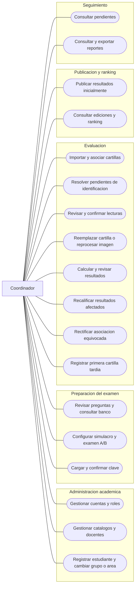

# Revisión del modelo mediante casos de uso del coordinador

Revisión conceptual de `MODELO_DDD_PROPUESTA.md`, contrastada con `3_requisitos v2.md` e `informe_reglas_de_negocio.md`. No se ejecutó una aplicación ni pruebas de software. «Cubierto» significa que el diseño permite explicar el caso, no que exista una implementación funcionando.

## Resultado actualizado

Las observaciones de esta revisión están incorporadas en `MODELO_DDD_PROPUESTA.md` versión 2. El usuario confirmó rectificación de asociaciones, recepción tardía, resolución trazable de entradas inválidas y participación sin grupo. Publicación y ranking sigue separado; consume un contrato de resultados completos, sin manipular cartillas o cálculos ajenos.

Los escenarios siguientes conservan su propósito y documentan el ajuste que ahora los cubre. «Resuelto en el diseño» no significa implementado ni probado.

## Mapa de casos de uso

Se usa un flowchart Mermaid como mapa de objetivos, no como notación UML formal de casos de uso. Las líneas indican acceso del coordinador, no orden obligatorio ni relaciones include/extend. Tener sesión y permiso es precondición común.

## Recorrido de los casos

### CU-01. Crear cuentas y asignar roles

**Referencia:** HF.1.1–HF.1.4; RN-002–RN-004.

**Recorrido:** el coordinador crea una cuenta, asigna DOCENTE y COORDINADOR a la misma persona y vincula una cuenta ESTUDIANTE a un estudiante ya registrado.

**Resultado esperado:** admite la combinación docente/coordinador; rechaza estudiante con otros roles, cuentas duplicadas y vincular una cuenta a dos estudiantes. El historial académico continúa aunque el estudiante no tenga cuenta o esta se desactive.

**Alcance actualizado:** el director administra todas las cuentas y roles y puede ejecutar las funciones del coordinador. El coordinador no crea ni modifica cuentas con rol DIRECTOR, ni asigna o retira ese rol; tampoco puede modificar una cuenta existente de director aunque también tenga otros roles. Estas restricciones deben aplicarse en el servidor al implementar la gestión de usuarios.

**Evaluación actual:** cubierto en el diseño. AccesoAppService incluye recuperación con verificación de identidad y credencial de uso único/caducidad. El canal se resuelve al implementar; no se agrega otro contexto. El primer coordinador se crea durante la puesta en marcha.

### CU-02. Preparar catálogo, ciclo y docentes

**Referencia:** HF.1.5; RN-006–RN-009, RN-038.

**Recorrido:** crear ciclo y grupos; registrar ejes y materias compartidos; registrar áreas; asignar materias al docente. Desactivar luego una materia usada en un examen antiguo.

**Resultado esperado:** la desactivación impide nuevas asignaciones, pero el examen anterior sigue consultable. Un área no se convierte en propietaria de las materias.

**Evaluación:** cubierto conceptualmente. No hace falta agregar clases por cada botón CRUD. La validación debe consultar vigencia de los catálogos al crear nuevas asignaciones, incluso si existen referencias históricas válidas.

### CU-03. Registrar estudiante y cambiar grupo o área

**Referencia:** HF.1.4, HF.1.6; RN-008.

**Recorrido:** registrar a Ana sin cuenta; asignarla al grupo mañana e Ingenierías; cambiarla al grupo tarde el 10 de octubre. Consultar resultados de un examen del día 9 y otro del día 10.

**Resultado esperado:** el del día 9 corresponde al grupo anterior; el del día 10 al nuevo, según periodos [inicio, fin). Un cambio académico posterior no cambia el examen que ya rindió en un simulacro.

**Evaluación actual:** cubierto con la decisión confirmada D3. Puede participar sin grupo y aparecer como «sin grupo». RectificacionHistorial conserva antes/después, responsable, fecha y motivo; valida periodos y actualiza estadísticas sin modificar puntajes ni puestos publicados.

### CU-04. Revisar preguntas y buscar contenido para un examen

**Referencia:** HF.2.2.1–HF.2.2.2; RN-010–RN-014.

**Recorrido:** filtrar banco por área, eje, materia y estado; abrir la versión enviada, aprobarla o devolverla con observación. Un coordinador que también es docente aprueba su propia pregunta.

**Resultado esperado:** registra versión, responsable y fecha; devolver vuelve a BORRADOR. Editar una aprobada crea versión nueva aprobada sin sobrescribir la anterior. Los exámenes existentes conservan su versión.

**Evaluación actual:** se incorporaron consultarBanco con filtros, tema en VersionPregunta y aprobación con versionVistaId. Si la versión cambió desde que se abrió, se solicita revisar la actual; no se aprueba silenciosamente otro contenido.

### CU-05. Crear simulacro y configurar examen A/B

**Referencia:** HF.3.1.1–HF.3.1.5; RN-015–RN-020.

**Recorrido:** crear simulacro y examen de Ingenierías; distribuir 100 puntos en dos ejes: 60 y 40. Por ejemplo, 30 preguntas de 2 puntos y 20 de 2 puntos. Seleccionar preguntas aprobadas para el área; generar B y aprobar la estructura.

**Resultado esperado:** A/B tienen las mismas 50 versiones y alternativas, con distinto orden. Otro examen de Ingenierías en el mismo simulacro se rechaza. Una distribución de 98 puntos cuando el máximo es 100 no se aprueba. Si faltan preguntas elegibles, informa cuántas faltan por materia y conserva el borrador.

**Evaluación actual:** se incorporaron estados BORRADOR/APROBADO del examen y BORRADOR/CONFIRMADO del simulacro, validaciones de estructura y rechazo de PreguntaId repetida. La generación del examen impreso permanece fuera de alcance.

### CU-06. Importar, revisar y confirmar una clave

**Referencia:** HF.3.2.1–HF.3.2.2; RN-020, RN-036.

**Recorrido:** cargar Excel, mostrar vista previa por cuadernillo y posición, señalar filas inválidas y confirmar una revisión completa.

**Resultado esperado:** rechaza posiciones duplicadas, faltantes, ajenas al cuadernillo y letras inexistentes. Una corrección de la respuesta de un ítem debe reflejarse en las posiciones equivalentes de A y B. Una importación fallida no sustituye la revisión confirmada anterior.

**Evaluación actual:** previsualizarClaveExcel e ImportadorClaveExcel cubren la carga. ConjuntoCalificacion enlaza revisiones A/B y política confirmadas y se activa como unidad. Una importación inválida no modifica el conjunto anterior.

### CU-07. Importar cartillas por lote y resolver identificación

**Referencia:** HF.4.1.1–HF.4.1.2.

**Recorrido:** subir un PDF o carpeta con 100 cartillas. Dos páginas no permiten leer el código del estudiante, una no permite identificar A/B y otra imagen está dañada.

**Resultado esperado:** conserva el estado por archivo/página, procesa las identificables y permite resolver las pendientes. No crea participación contra un estudiante supuesto ni sustituye una cartilla vigente por un simple reintento de carga.

**Evaluación actual:** ImportacionCartillas y EntradaImportacion ya representan el archivo/página, la identificación pendiente, errores y estado. Registrar recepción y asociar la entrada se confirma atómicamente. El lote de importación sigue siendo distinto del lote de calificación.

**Borde resuelto:** reintentar operacionId devuelve el resultado previo. La sustitución intencional tiene operación nueva y motivo. Pendientes del examen bloquean la entrega completa. El usuario autorizó descartar entradas duplicadas/ajenas con motivo y evidencia, y sustituir imágenes ilegibles conservando el enlace; nunca se asigna cero automáticamente.

### CU-08. Revisar lecturas dudosas

**Referencia:** HF.4.1.3; RN-022, RN-024.

**Recorrido:** abrir una respuesta con confianza 75 %, otra sin confianza y otra con dos marcas y confianza 99 %. Comparar cada una con la imagen y confirmar lo observado.

**Resultado esperado:** las tres requieren revisión. Dos marcas reales producen MULTIPLE_CONFIRMADA, respuesta efectiva en blanco y 0 puntos. Una marca reconocida incorrectamente puede corregirse conservando antes, después, responsable y motivo.

**Evaluación actual:** se explicita ESPERA_REEMPLAZO_LEGIBLE. La revisión muestra la imagen; sin evidencia suficiente no se confirma blanco ni se calcula cero. El reemplazo conserva la imagen anterior.

### CU-09. Reemplazar cartilla, reprocesar imagen y corregir asociación

**Referencia:** HF.4.1.1, HF.4.2.3; RN-021–RN-024.

**Recorrido normal:** recibir otra cartilla del mismo estudiante y examen con motivo de sustitución; o reprocesar la imagen existente.

**Resultado esperado:** reemplazo crea recepción; reprocesamiento crea lectura. Ninguno crea otro intento académico. Si el examen ya está publicado, la corrección terminada debe llegar al flujo de recalificación y publicación automática.

**Evaluación actual:** confirmar una nueva lectura cuando existía un cálculo programa el recálculo; la validación posterior desencadena la publicación automática si el examen ya estaba publicado.

**Caso resuelto con D1:** RectificacionAsociacion invalida la asociación origen sin borrarla y registra una recepción destino enlazada. Se valida una sola participación válida por estudiante/simulacro. Los exámenes afectados se recalculan; sus ediciones previamente publicadas se sustituyen juntas. Una participación sin recepción válida deja de integrar futuras publicaciones.

### CU-10. Calcular y revisar resultados

**Referencia:** HF.4.2.1–HF.4.2.2; RN-018–RN-019, RN-025–RN-028.

**Recorrido:** lectura confirmada de 50 preguntas de 2 puntos: 30 correctas, 15 incorrectas y 5 blancos. Calcular sin penalización y revisar.

**Resultado esperado:** 60 puntos. Con descuento expresamente configurado de 0,25 por incorrecta: 56,25. Las marcas múltiples confirmadas están dentro de blancos. Si la suma queda negativa, total 0. No se redondea.

**Evaluación actual:** EvaluacionAppService expone consultarResultadosCalculados y revisarCalculo; se conserva responsable y fecha de revisión. La consulta interna del coordinador está separada de la edición oficial que consulta el estudiante.

### CU-11. Publicar por primera vez y consultar ranking

**Referencia:** HF.4.2.2, HF.6.1; RN-028, RN-035.

**Recorrido:** hay 100 participaciones: 98 cálculos revisados y dos pendientes. El coordinador intenta publicar. Resuelve los dos casos y publica nuevamente.

**Resultado esperado:** el primer intento explica los bloqueos; el segundo genera una edición completa de ese examen, con A/B juntos. Puntajes 80, 80 y 70 producen puestos 1, 1 y 3. No necesita esperar resultados de otra área.

**Evaluación actual:** la validación incluye importaciones sin resolver, además de las participaciones registradas. consultarEdiciones está disponible en aplicación. La publicación toma un contrato de entrega completo y guarda su propia instantánea de puntaje, puesto y detalle.

### CU-12. Recalificar después de corregir la clave o una lectura

**Referencia:** HF.4.2.3; RN-020, RN-023, RN-028.

**Recorrido:** corregir una clave que cambia una pregunta, identificar sus posiciones en A/B y recalcular a los participantes afectados. Revisar el lote. El examen ya tiene publicación.

**Resultado esperado:** nuevos cálculos con revisiones identificadas; edición nueva automática al terminar la validación; puntaje y ranking cambian juntos, incluso si un puntaje baja. La edición anterior permanece consultable. Corregir la clave afecta a quienes la usaron; cambiar la política afecta al conjunto correspondiente; corregir una lectura permite reutilizar cálculos ajenos que siguen válidos.

**Evaluación actual:** se definió alcance de recálculo y reutilización solo con iguales cartilla, lectura y conjunto. El aviso de entrega es durable; SolicitudPublicacion permite reintentos únicos por entrega. Activar exige reservar/comprobar la versión actual y confirmar edición y referencia vigente atómicamente. Un lote obsoleto no se publica. Este protocolo está diseñado para la aplicación modular con base transaccional única.

### CU-13. Consultar pendientes y reportes

**Referencia:** HF.6.1, HF.6.4–HF.6.5; RN-008, RN-035, RN-037.

**Recorrido:** el coordinador abre su panel y encuentra preguntas por revisar, cartillas sin identificar, lecturas dudosas, cálculos por revisar y publicaciones pendientes. Abre un pendiente y llega a la acción necesaria.

**Resultado esperado:** contadores basados en estados reales, filtrables por examen; los reportes distinguen incorrectas de blancos, usan la edición seleccionada y el grupo a fecha del examen.

**Evaluación actual:** consultarPendientes y ConsultaPendientes reúnen estados de cada contexto mediante contratos de consulta. Cada pendiente enlaza su acción. Reportes avanzados siguen en R4 opcional; no bloquean el MVP R1–R3.

### CU-14. Registrar primera cartilla después de publicar

**Decisión confirmada D2.** El coordinador registra que faltaba cargar la cartilla de una persona que sí rindió, indicando motivo. Se comprueba estudiante, simulacro, examen y A/B, se conserva la recepción y se procesa con el conjunto activo. No se permite otra área para el mismo estudiante en ese simulacro.

**Resultado esperado:** hasta completar y validar permanece la edición previa; después se publica automáticamente una edición completa que incluye al nuevo participante y recalcula todos los puestos. Es diferente de reemplazar la cartilla de una participación existente.

### CU-15. Resolver descarte, imagen ilegible y errores administrativos

**Decisiones confirmadas D1 y D3.** Una página duplicada o ajena puede descartarse con motivo y responsable, conservando el archivo. Una imagen ilegible espera reemplazo y conserva evidencia. Si ya originó una recepción, se requiere reemplazo o rectificación; no se elimina mediante descarte de archivo.

**Resultado esperado:** nunca aparece un cero inventado. Las entradas pendientes bloquean la entrega completa; una sustitución enlaza la entrada nueva y no oculta su propio estado pendiente. Rectificar grupo histórico actualiza estadísticas sin alterar ediciones de puntaje/ranking. Rectificar una cartilla sí recalcula los exámenes afectados; si el origen queda sin participantes, puede publicarse una edición correctiva vacía con su motivo.

## Observaciones y correcciones incorporadas

| Observación | Resolución en Mermaid |
|---|---|
| Contextos demasiado conectados | Mapa de contratos y clases separadas por contexto. Referencias externas por Id; repositorios privados. |
| Publicación accede a entidades de Evaluación | EntregaValidada y resultados transferibles; Publicación conserva su instantánea y detalle. |
| Carga por lote e identificación ausentes | ImportacionCartillas, EntradaImportacion y estados operativos. |
| Reintentos duplican recepciones/ediciones | Identificador de operación y unicidad de entrega publicada. |
| Rectificación de estudiante/examen bloqueada | RectificacionAsociacion con evidencia, conservación de origen y activación coordinada de ediciones afectadas. |
| Cartilla tardía sin regla | Admitida con motivo; nueva edición automática al validar. |
| Imagen ilegible o descarte ambiguos | Reemplazo legible o descarte justificado; nunca cero supuesto. |
| Falta revisión previa a publicación | Consulta interna y revisarCalculo con responsable/fecha. |
| Recalificación/publicación pueden quedar a medias | Aviso durable, solicitud pendiente, reserva de versión y activación atómica. |
| Claves A/B y política sin selección conjunta | ConjuntoCalificacion confirmado e inmutable. |
| Importación Excel ausente | Vista previa, validación completa y adaptador. |
| Tema, consulta del banco y panel ausentes | Tema versionado, filtros y ConsultaPendientes. |
| Falta historial de corrección académica | RectificacionHistorial; admisión sin grupo; estadísticas rectificables sin cambiar puntajes. |
| Recuperación de acceso no descrita | Operaciones con verificación de identidad y credencial de uso único/caducidad. |
| Estados y ediciones poco claros | Estados explícitos y consulta de ediciones; publicado se deriva de la edición, no del último cálculo. |

## Resultado de esta iteración

Las decisiones consultadas fueron respondidas y están incorporadas. No quedan preguntas de negocio pendientes de esta revisión. La cobertura es de diseño: los ejemplos son recorridos razonados y resultados esperados, no pruebas ejecutadas. La conversión a `.mdj` continúa pendiente de la revisión del Mermaid.
